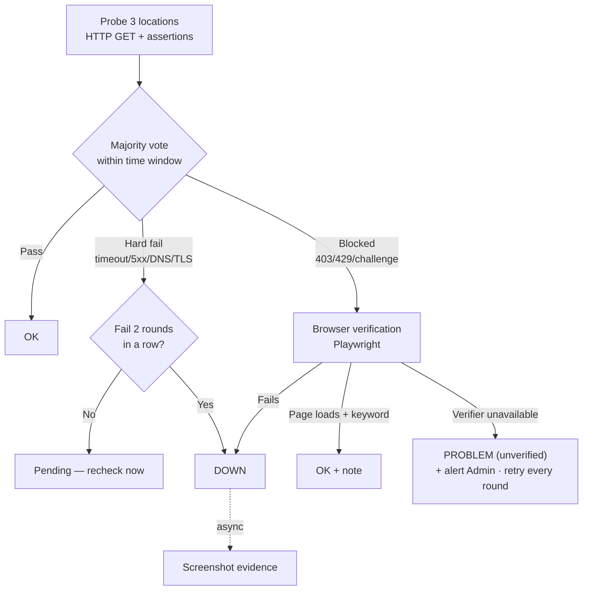
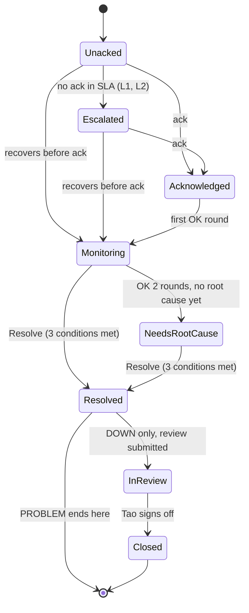
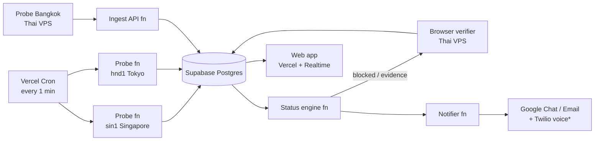

<!--
Source: Claude Doc "PRD — DxT Website Monitoring Platform" https://claude.ai/artifact/Mz596TqTLewVQ3EjRBqudL (rev 168)
Converted to Markdown: 2026-09-28. The Claude Doc is the source of truth — re-export this file when it changes.
Settled conflicts: docs/decisions.md wins over this file and the design spec.
Precedence: on scope, priority, architecture and budget this PRD wins; on screen behaviour, status logic, UI copy and formats docs/dxt-monitor-design-spec.md wins.
-->

# PRD — DxT Website Monitoring Platform

2026-09-25 · Jirawat Piyakit

## 1. Overview & Problem

สร้างระบบ Website Monitoring ของ DxT เอง ให้ตรวจ 17 เว็บที่เราดูแลทุก 1–5 นาทีจากหลาย location แจ้งเตือนทีมทันที และมี escalation ที่มีเจ้าของชัดเจน — เป้าหมายคือ **ไม่มีเคสที่ลูกค้ารู้ก่อนเราว่าเว็บล่ม**

**ที่มา:** CEO ตั้ง monitor แบบรายชั่วโมงไว้แล้ว และมอบหมายให้ Tao ทำเป็น process ถาวร พร้อม alert ถึงทุกคนที่เกี่ยวข้อง, escalation process และ ownership สำหรับทุก 🟠 PROBLEM / 🔴 DOWN

**ปัญหาของ setup ปัจจุบัน:**

- ตรวจทุก 1 ชั่วโมง → เว็บอาจล่มได้นานถึง ~59 นาทีก่อนเรารู้ ซึ่งนานพอให้ลูกค้าเจอก่อน
- Monitor ตรวจไม่ผ่านบางเว็บ (Tubtong, Cando Asia) ทั้งที่เว็บเข้าได้ — น่าจะโดน WAF / bot protection บล็อก ทำให้ผลไม่น่าเชื่อถือและต้องมีคนมาตีความเอง
- ยังไม่มี owner ต่อเว็บ, ไม่มี acknowledgement, ไม่มี escalation และไม่มี history/uptime report ให้ลูกค้า

**ทำไมสร้างเอง (ไม่ใช้ SaaS อย่าง UptimeRobot / Better Stack):** ควบคุม status logic แบบ OK/PROBLEM/DOWN ของเราได้เต็มที่, ต่อ Google Chat และ workflow ภายในได้ตรงใจ, ออก uptime report ในแบรนด์ DxT ให้ลูกค้าได้ และต่อยอดเป็นบริการ managed monitoring ได้ ข้อแลกคือเราต้องดูแลความเสถียรของตัว monitor เอง (ดู Section 9)

**"Enterprise-grade" ในที่นี้หมายถึง:** multi-location verification ก่อนประกาศ DOWN, false alert ต่ำ, audit trail ครบทุก incident, role-based access, และ monitor ที่ถูก monitor อีกชั้น

## 2. Goals, Non-goals & Success Metrics

**Goals**

1. ตรวจจับ DOWN ภายใน 3 นาที สำหรับเว็บ Tier 1 และ 10 นาทีสำหรับ Tier อื่น
2. ทุก alert มีเจ้าของ 1 คนที่ต้อง acknowledge และมี escalation อัตโนมัติถ้าไม่มีคนรับ
3. False DOWN ต่ำมาก — เคส "monitor ตรวจไม่ผ่านแต่เว็บยังเข้าได้" ต้องจบที่ OK + note โดยไม่ต้องมีคนตีความ
4. มี history, uptime % และ incident timeline พร้อมส่งลูกค้าได้

**Success metrics** (วัดหลังใช้งานจริง 30 วัน)

| Metric | Target |
|---|---|
| Incident ที่ลูกค้าแจ้งเราก่อน | 0 |
| MTTD (Mean Time to Detect) — Tier 1 DOWN | ≤ 3 นาที |
| MTTA (Mean Time to Acknowledge) — DOWN | ≤ 15 นาที |
| MTTA — PROBLEM | ≤ 60 นาที (เวลาทำการ) |
| False DOWN alert | < 1 ครั้ง/เดือน ทั้งระบบ |
| Incident ที่มี owner + root cause บันทึกไว้ | 100% |
| Uptime ของตัว monitor เอง | ≥ 99.9% |

**Non-goals (v1)**

- APM / server metrics (CPU, RAM, log) — เราดูจากมุมผู้ใช้ภายนอกเท่านั้น
- Auto-remediation (restart server อัตโนมัติ)
- Real User Monitoring และ SEO/performance audit
- Security scanning เต็มรูปแบบ (v1 ทำแค่ SSL/domain expiry และ content-change/defacement detection — S09c, S09d, D-041)
- การเฝ้าว่า DNS / NS record ถูกเปลี่ยน และการติด blacklist (Google Safe Browsing / Web Risk) — backlog P2 ตามการตัดสินใจ D-041 (Safe Browsing API ตัวฟรีใช้ได้เฉพาะงานที่ไม่ใช่เชิงพาณิชย์ ต้องตรวจเงื่อนไขก่อนใช้)

## 3. Users, Roles & Permissions

ระบบมี 5 role ควบคุมด้วย RBAC; ทุก action ที่เปลี่ยน config หรือสถานะ incident ถูกเก็บใน audit log

| Role | ใคร | ทำอะไรได้ |
|---|---|---|
| Admin | Tao (Ops lead) | ทุกอย่าง: เพิ่ม/ลบเว็บ, ตั้ง escalation policy, จัดการ user |
| Responder | Dev / ผู้ดูแลเว็บ | Ack / resolve incident, เขียน note & root cause, ตั้ง maintenance window / mute และ Mark client update ของเว็บที่ตัวเองเป็น owner; ขณะอยู่เวร on-call → Ack/resolve ได้ทุกเว็บ Tier 1 |
| Stakeholder | Thee & Bua, AM / PM ฝั่งลูกค้า | ดู dashboard, รับ alert/digest, ดาวน์โหลด report; AM กด Mark client update / Not needed ได้เฉพาะลูกค้าของตัวเอง |
| Viewer | ทีมทั่วไป | ดู dashboard และ history อย่างเดียว |
| Client (Phase 3) | ลูกค้า | ดู status page / uptime report เฉพาะเว็บของตัวเอง |

- Login ผ่าน Google Workspace SSO (OAuth client แบบ Internal + domain บริษัท) และต้องมีอีเมลอยู่ใน allowlist ที่ Admin เพิ่มไว้พร้อม role เท่านั้นจึงสร้างบัญชีได้ — 2-step บังคับโดย Google Workspace ทุกบัญชี (ปิดเองไม่ได้) ระบบจึงไม่เช็คหรือล็อกซ้ำ; ทุกคนที่ได้ role ต้องยืนยันว่าหน้า 2-Step Verification ของตัวเองปิดไม่ได้ (D-007)
- ทุก user ต้องผูก notification channel อย่างน้อย 1 ช่องทาง (Google Chat หรือ email) ก่อนจะถูกตั้งเป็น owner ได้
  เปลี่ยน role หรือ deactivate user ต้องผ่าน **Used in check** ก่อน: แสดงว่าคนนั้นอยู่ใน escalation level ไหน, เป็น AM ของลูกค้ากี่ราย, เป็น owner/backup กี่เว็บ และมีเวร on-call เมื่อไร แล้วบังคับ reassign ให้ครบก่อนยืนยัน

## 4. Monitored Estate

v1 ครอบคลุม 17 เว็บตามรายชื่อของ CEO แต่ละเว็บมี Tier ที่กำหนดความถี่ในการตรวจและ response SLA — Tier ด้านล่างเป็นข้อเสนอ รอยืนยันกับ CEO

| Tier | ความหมาย | Check interval | Response hours |
|---|---|---|---|
| Tier 1 | เว็บลูกค้า enterprise / มีธุรกรรมหรือ traffic สูง | 1 นาที | 24/7 |
| Tier 2 | เว็บลูกค้าทั่วไป | 3 นาที | จ–ศ 09:00–18:00 |
| Tier 3 | เว็บภายใน / กลุ่ม DxT | 5 นาที | เวลาทำการ (จ–ศ 09:00–18:00) |

**เวลาทำการ** = จันทร์–ศุกร์ 09:00–18:00 ไม่รวมวันหยุดบริษัท — Tier 2 และ Tier 3 ใช้ response hours ค่าเดียวกัน (แก้ได้ที่ Settings › Organisation เท่านั้น ต้อง confirm พร้อมเหตุผล) DOWN ของ Tier 2–3 โพสต์ทันทีทุกเวลา แต่ escalation timer หยุดนอก response hours แล้วนับต่อ 09:00; PROBLEM นอก response hours พักไว้ส่ง 09:00 — Tier 1 นอกเวลาทำการใช้คนที่อยู่เวร on-call แทน Primary owner

| # | Site | Proposed tier | หมายเหตุ |
|---|---|---|---|
| 1 | Bangkok Airways – Taiwan | Tier 1 | ควรมี probe ในเอเชียตะวันออก (Tokyo/HK) |
| 2 | Bangkok Airways – China | Tier 1 | ผู้ใช้อยู่จีน — probe นอกจีนอาจไม่สะท้อนประสบการณ์จริง (ดู Section 13) |
| 3 | ENEOS Industrial | Tier 1 |  |
| 4 | MuvMi | Tier 1 |  |
| 5 | realme.link | Tier 1 |  |
| 6 | Fuji Links | Tier 2 |  |
| 7 | Tubtong | Tier 2 | Monitor ตรวจไม่ผ่านเป็นพักๆ — ใช้ browser verification (Section 5) |
| 8 | Cando Asia | Tier 2 | เหมือน Tubtong — น่าจะติด bot protection |
| 9 | ORCA Thailand | Tier 2 |  |
| 10 | WeCare Studio | Tier 2 |  |
| 11 | WeCare Asia | Tier 2 |  |
| 12 | VOCA | Tier 2 |  |
| 13 | EQHO | Tier 2 |  |
| 14 | DxT | Tier 2 | เว็บบริษัท / หน้าร้าน — ยกจาก Tier 3 ตามรีวิว |
| 15 | DxT Solutions | Tier 3 |  |
| 16 | DxT AI | Tier 3 |  |
| 17 | DxT Games | Tier 3 |  |

แต่ละเว็บต้องมีข้อมูลครบก่อนเปิด monitor: URL หลัก + key pages, Primary owner, Backup owner, ลูกค้า/ผู้ติดต่อฝั่งลูกค้า, hosting provider และที่เก็บ credential สำหรับเข้าไปแก้ (อ้างอิงเท่านั้น ไม่เก็บรหัสในระบบ)

## 5. Status Model & Verification Logic

ใช้ 3 สถานะตามที่ CEO กำหนด บวก MAINTENANCE อีก 1 สถานะสำหรับช่วงที่ตั้งใจปิดเว็บ กฎสำคัญที่สุด: **DOWN ต้อง confirm จากหลาย location และหลายรอบเสมอ ส่วน "monitor โดนบล็อก" ไม่ใช่ DOWN**

| Status | ความหมาย | เงื่อนไข | Alert |
|---|---|---|---|
| 🟢 OK | เว็บเข้าได้ปกติ | ผ่านทุก assertion หรือผ่าน browser verification (แนบ note ได้) | ไม่มี / recovery message |
| 🟠 PROBLEM | เข้าได้ แต่มีปัญหา | ดูรายการ PROBLEM triggers ด้านล่าง | Owner + ทีม, escalation ช้า |
| 🔴 DOWN | Confirm ว่าเข้าไม่ได้ | Hard fail (timeout / 5xx / DNS / TLS) ≥ 2 จาก 3 location ติดกัน 2 รอบ → DOWN ทันที หรือ blocked แล้ว browser verification fail | ทุกคน + escalation เร็ว |
| 🔵 MAINTENANCE | อยู่ใน maintenance window | ตั้งล่วงหน้าโดย owner | Suppress (ยังเก็บผล) |

**Check round (ต่อเว็บต่อรอบ)**



**รอบ (round)** = ผลล่าสุดของแต่ละ location ที่เข้ามาภายใน time window — Tier 1: 90 วินาที, Tier 2–3: interval + 30 วินาที เพราะ probe บน Vercel Cron กับ probe Bangkok รันไม่ sync กัน location ที่ไม่มีผลใน window ถูกตัดออกจากการโหวต; เหลือ < 2 location → ไม่เปลี่ยนสถานะ + alert Admin

ทุกครั้งที่ผลเป็น fail รอบแรก ระบบ recheck ทันทีภายใน 30 วินาที ไม่รอรอบถัดไป เพื่อให้ Tier 1 confirm DOWN ได้ภายใน ~2 นาที — hard fail ไม่รอ browser verifier เพราะถ้า HTTP timeout หรือ 5xx จาก 3 ประเทศ browser ก็ไม่ได้ข้อมูลเพิ่ม และทำให้ verifier ไม่เป็น single point of failure ของการประกาศ DOWN

**Failure = อย่างใดอย่างหนึ่ง:** DNS resolve ไม่ได้, connect/response timeout > 30 วินาที, HTTP 5xx, TLS handshake พังหรือ cert หมดอายุแล้ว

**Blocked (inconclusive) = ไม่ใช่ failure:** HTTP 403/429/503 ที่มี signature ของ WAF หรือ challenge page (เช่น Cloudflare `cf-mitigated`, CAPTCHA) → ส่งต่อ browser verification ถ้าผ่าน = OK + note "Automated check blocked by bot protection; verified via browser" ตรงตาม rule ของ CEO ทางแก้ถาวรคือ allowlist IP/User-Agent ของ probe ใน WAF ของเว็บนั้นๆ

**Browser verification spec**

- Timeout 20 วินาทีต่อหน้า, ใช้ Chromium ปกติ (ไม่ใช้ stealth plugin — ถ้า browser ปกติโดนบล็อก ผู้ใช้จริงก็อาจโดนด้วย ควรเป็น PROBLEM ไม่ใช่ถูกซ่อน)
- สูงสุด 3 sessions พร้อมกัน (พอสำหรับ 17 เว็บบน VPS 2 GB)
- Screenshot เก็บใน Supabase Storage 30 วัน แนบกับ incident
- ใช้เฉพาะกรณี blocked — ไม่อยู่ใน critical path ของ hard fail (สำหรับ DOWN จาก hard fail verifier แค่ถ่าย screenshot เป็นหลักฐานแบบ async); verifier ล่มขณะเว็บ blocked → PROBLEM (unverified) ทันที + alert Admin เรื่อง verifier และตรวจซ้ำทุกรอบ — ไม่มีช่วงรอ 10 นาที เพราะเมื่อยืนยันไม่ได้ ระบบต้องไม่แสดงว่าเว็บ OK (ตาม design spec §6 และ board StatusModel)
- Phase 0: ยิง Tubtong และ Cando Asia ด้วย HTTP ปกติเทียบ Playwright เพื่อเก็บ signature ของ challenge page จริง

**PROBLEM triggers**

- Response time เกิน threshold 3 รอบติด (default: Tier 1 > 3 วินาที, Tier 2–3 > 5 วินาที)
- Keyword ที่ควรมีหายไป หรือเจอ keyword ต้องห้าม (เช่น "Database error", "Index of /", คำพนัน/คำสแปม) — จับ defacement
- หน้าหลัก OK แต่ key page (เช่น booking, contact form) คืน 4xx/5xx
- Fail เฉพาะ 1 location ต่อเนื่อง ≥ 5 นาที ขณะที่ location อื่นผ่าน (ปัญหาเฉพาะภูมิภาค เช่น CDN)
- SSL certificate หมดอายุภายใน 14 วัน / domain หมดอายุภายใน 30 วัน
- Redirect ไป domain ที่ไม่อยู่ใน allowlist ของเว็บนั้น (สัญญาณ hijack)

**Recovery:** รอบแรกที่ majority location ผ่าน → ส่ง RECOVERED (reply ใน thread + email) พร้อม downtime duration และ incident เข้าสถานะ Monitoring; ผ่านครบ 2 รอบติด → เว็บกลับเป็น OK และ incident เป็น Needs root cause (ถ้ายังไม่เขียน) — ปิด incident ต้องกด Resolve เองตามเงื่อนไขใน Section 8 ข้อความ recovered ใช้คำว่า "Needs a root cause before it can be resolved"

**สถานะเว็บจากหลาย monitor:** สถานะเว็บ = สถานะที่แย่ที่สุดของ monitor ทั้งหมด โดยมีแค่ monitor หน้าหลัก (`is_primary`) ที่ทำให้เว็บ DOWN ได้ — key page, SSL, domain ให้ผลสูงสุดแค่ PROBLEM

**Location ที่เสียเอง:** ถ้า location ใด fail เกิน 50% ของเว็บทั้งหมดในรอบเดียว ให้ถือว่า location นั้นไม่มีข้อมูลในรอบนั้น (ไม่นับเป็นเสียงโหวต) เพื่อกัน probe พังแล้วทำให้หลายเว็บ DOWN พร้อมกัน

**Uptime:** uptime ของเว็บ = 1 − นาทีที่ DOWN / นาทีในช่วง (ตัดช่วง maintenance ออกทั้งสองฝั่ง); PROBLEM นับเป็น up, ช่วง mute ยังนับปกติ; ภาพรวมทุกเว็บ = เฉลี่ยถ่วงตามเวลาของทุกเว็บ — duration ของ incident นับจาก check แรกที่ fail ส่วนเวลารอ ack นับจากเวลา confirm DOWN

## 6. Functional Requirements

Priority: **P0** = ต้องมีใน MVP, **P1** = ก่อนประกาศใช้งานทั้งทีม, **P2** = ภายหลัง

| ID | Requirement | Priority |
|---|---|---|
| FR-01 | CRUD เว็บ (site) และ monitor หลายตัวต่อเว็บ: URL, method, expected status, timeout, keyword must/must-not contain, custom headers, thresholds แยกต่อเว็บ | P0 |
| FR-02 | HTTP(S) check จาก 3 location ตาม interval ของ Tier, เก็บ status code, response time, TTFB, IP ที่ resolve ได้, error message | P0 |
| FR-03 | Status engine ตาม Section 5 (majority vote, consecutive rounds, immediate recheck) | P0 |
| FR-04 | Browser verification ตาม spec ใน Section 5 เมื่อ blocked; สำหรับ DOWN จาก hard fail ถ่าย screenshot เป็นหลักฐานแบบ async (ไม่บล็อกการประกาศ DOWN) | P0 |
| FR-05 | Dashboard ภาพรวม: สถานะทุกเว็บแบบ realtime, สรุป X/17 OK, filter ตาม Tier/owner/ลูกค้า, sparkline response time 24 ชม. | P0 |
| FR-06 | Incident อัตโนมัติเมื่อสถานะเปลี่ยนเป็น PROBLEM/DOWN พร้อม timeline, ack/resolve, note, root cause, เวลา MTTA/MTTR — lifecycle และเงื่อนไข Resolve 3 ข้อตาม Section 8; ack และ resolve มี undo 10 วินาที (Chat, email และ webhook ถูก hold ไว้จนหมดเวลา undo); มีหน้า incident detail และ site detail บนมือถือด้วย — ทุก incident / ทุกเว็บบนมือถือแตะแล้วเปิดหน้า detail ของตัวเอง (design spec §17) | P0 |
| FR-07 | Alert ผ่าน Google Chat + Email พร้อมปุ่ม Acknowledge (link ไปหน้า incident + Google SSO session, ใช้บนมือถือได้เต็มที่) | P0 |
| FR-08 | Site detail: uptime % (24h / 7d / 30d / 90d), response time chart แยก location, incident history, check log | P0 |
| FR-09a | Escalation พื้นฐาน L0 + L1 (owner → backup + Tao) | P0 |
| FR-09b | Escalation เต็ม L2–L3 + on-call schedule (Section 8) | P1 |
| FR-10a | Maintenance window แบบครั้งเดียว: ตั้งล่วงหน้า, suppress alert, ไม่นับเข้า uptime; ยาวเกิน 24 ชม. ต้องให้ Admin อนุมัติ และแสดงใน digest ตลอดช่วง (Admin อนุมัติ window ของตัวเองได้); เริ่ม window ทันทีบนเว็บที่ DOWN หรือมี incident เปิดอยู่ไม่ได้ — เสนอ Mute แทน; ต้องใส่เหตุผลก่อนบันทึก; จบก่อนเวลา / แก้ / ยกเลิกได้ (confirm + เหตุผล + audit log) | P0 |
| FR-10b | Maintenance window แบบเป็นรอบ (recurring) | P1 |
| FR-11 | SSL certificate expiry + domain expiry (WHOIS/RDAP) check วันละครั้ง | P1 |
| FR-12 | Daily digest 09:00 และ Weekly summary วันจันทร์ ใน format เดียวกับที่ CEO ใช้ (🟢/🟠/🔴 + Overall X/17) | P1 |
| FR-13 | Audit log ทุกการเปลี่ยน config, ack, resolve, maintenance, mute | P1 |
| FR-14 | Mute site: ต้องใส่เหตุผล, สูงสุด 24 ชม. (`muted_until`), แสดงบน dashboard และ digest ตลอดที่ mute; mute หยุดเฉพาะ alert ใหม่ — incident ที่เปิดอยู่ยังไล่ escalation, L3 FYI และ client update ตามปกติ และ mute ไม่นับเป็น ack (หน้า mute ต้องเตือนเมื่อเว็บมี incident เปิดอยู่); จบก่อนเวลา / แก้ / ยกเลิกได้ | P1 |
| FR-15 | Monthly uptime report (PDF) ต่อลูกค้า พร้อม incident summary | P2 |
| FR-16 | Public/Client status page แยกต่อลูกค้า (custom subdomain) | P2 |
| FR-17 | Synthetic transaction (Playwright script หลาย step เช่น search → booking page) | P2 |
| FR-18 | Post-incident review template ผูกกับ incident DOWN ทุกครั้ง; ส่ง review ให้ Tao sign-off (In review → Closed) | P2 |
| FR-19 | Public API + webhook out สำหรับต่อระบบอื่น (เช่น CRM / ticketing) | P2 |
| FR-20 | Client-update track แยกจาก escalation (Section 8): @mention AM พร้อม draft ข้อความ, การ์ด Client update บนหน้า incident (Mark client updated / Not needed + เหตุผล / Copy draft) บันทึกคนและเวลา | P1 |
| FR-21 | Monitor-fault mode: เมื่อ engine heartbeat หาย dashboard แสดง banner และข้อมูล "as of" เวลาล่าสุด; มี hand check (เปิด manual incident ได้) โพสต์ L0 ผ่าน fallback sender, L1+ และ client-update reminder ส่งด้วยมือ (Escalate now) จน engine กลับมา | P1 |
| FR-22 | คู่มือการใช้งานในแอป (User guide): tab ใน sidebar, ค้นหาได้, แยกตาม role และงาน (รับ alert, ack, mute/maintenance, resolve, on-call, client update), อธิบายสถานะและ badge; เปิดจากมือถือได้; หัวข้อต่อ role ตามตารางใน design spec §18 (role chip: Responder, On-call, Stakeholder, Viewer, Admin; เปิดมาเลือก role ของคนอ่านไว้ให้) | P1 |

## 7. Alerting & Notifications

Google Chat เป็นช่องทางหลัก ส่วน Email เป็น record และ fallback — หนึ่ง incident = หนึ่ง thread ใน Space ไม่ส่งข้อความใหม่ทุกรอบ check; v1 ไม่มี LINE, SMS หรือโทรศัพท์

**Channels**

| Channel | ใช้สำหรับ | หมายเหตุ |
|---|---|---|
| Google Chat — Space "DxT Website Alerts" (incoming webhook) | ทุก alert, @mention owner, 1 thread ต่อ incident | ไม่มีค่าใช้จ่ายเพิ่ม (อยู่ใน Google Workspace); ใช้ `threadKey` = incident id ให้ reminder, escalation, recovery ต่อใน thread เดิม |
| Email (Resend) | ทุก alert DOWN/PROBLEM, digest, report | Record + fallback เมื่อส่ง Google Chat ไม่สำเร็จ |
| Voice call (Twilio) — **ข้อเสนอ, รออนุมัติ** | โทรเมื่อ Tier 1 DOWN ยังไม่มี ack ถึง L2 (T+30 นาที) — เสียงอ่านชื่อเว็บ + กด 1 เพื่อ Ack; design ปัจจุบันผูกสายนี้กับ step L2 (CEO) ต้องยืนยันผู้รับสาย (Section 13); ตั้งค่าได้แต่ปิดไว้จนกว่าจะอนุมัติ | เบอร์ไทย ~$22–25/เดือน + $0.10/นาที ถึงมือถือไทย; ใช้จริงไม่กี่สาย/เดือน → รวมราว $23–26/เดือน; ปิดช่องว่างเรื่อง DND ที่ Google Chat ปิดไม่ได้ |
| Google Chat app (Chat API) | DM ถึง owner โดยตรง, กด Acknowledge ในแชทได้เลย | P2 — ต้องตั้ง Chat app + service account |

**Acknowledge ใน v1:** ปุ่มบน card เปิด link ไปหน้า incident (ลิงก์เดียวกันสำหรับทุกคน) หน้า incident ใช้ session Google SSO ที่ login ค้างไว้บนมือถือ ระบบจึงบันทึกได้ว่าใคร Ack จริง แล้วกด Ack ได้ใน 1 tap — ไม่ใช้ signed link ผูก user เพราะ card ถูกโพสต์ใน Space ที่ทุกคนเห็น คนอื่นจะ Ack แทน owner ได้ — webhook รับการกดปุ่มกลับมาไม่ได้ จึงใช้ link แทนจนกว่าจะมี Chat app — หลังกด Ack มี undo 10 วินาที: ข้อความ Chat, email และ webhook ถูก hold ไว้จนหมดเวลา ("Posting to Chat, email and webhooks in N s — nothing is sent until then")

**Routing matrix**

| Event | Owner (@mention) | Alerts Space | Email | CEO |
|---|---|---|---|---|
| 🔴 DOWN | ✓ | ✓ | ✓ | Tier 1: @mention ที่ L2 (+30 นาที, ข้อเสนอ รอ CEO) และ FYI ที่ L3 ถ้ายังล่ม; Tier 2–3: ไม่ page — เห็นใน digest |
| 🟠 PROBLEM | ✓ | ✓ | ✓ | Digest เท่านั้น |
| OK + note (verification) | — | — | — | Digest เท่านั้น |
| 🟢 Recovery | ✓ (reply ใน thread) | ✓ | ✓ | ✓ ถ้าเคยถูก @mention ใน incident นั้น |
| SSL/Domain ใกล้หมด | ✓ | — | ✓ | — |
| Client update due (Tier 1 DOWN 15 นาที / Tier 2 DOWN 60 นาทีใน response hours) | AM ของเว็บ (@mention พร้อม draft) | ✓ (reply ใน thread) | ✓ ถึง AM | — |
| Resolved | — (reply ไม่ @mention) | ✓ | ✓ ถึงทุกคนที่ได้ DOWN email ของ incident นั้น | ตามข้อก่อนหน้า |
| Monitor fault — engine heartbeat หาย > 3 นาที | คนที่อยู่เวร on-call | ✓ | ✓ ถึง Admin (Tao) | — |
| Probe 1 location heartbeat หาย > 3 นาที | — | — | ✓ ถึง Admin (Tao) เท่านั้น ไม่ page | — |

**Noise control**

- Dedupe: 1 incident = 1 thread; reminder ทุก 15 นาที (DOWN) / 60 นาที (PROBLEM) เป็น reply ใน thread เดิมจนกว่าจะ ack
- Flapping: เปลี่ยนสถานะ ≥ 3 ครั้งใน 30 นาที → รวมเป็น incident เดียวพร้อม tag "flapping" ไม่ส่ง recovery ทุกครั้ง — ส่งสรุปครั้งเดียวเมื่อ OK ต่อเนื่องครบ 15 นาที
- Quiet hours: PROBLEM ของ Tier 2–3 ที่เกิดนอก response hours ของ Tier นั้น (จ–ศ 09:00–18:00) ไม่ส่งทันที — พักไว้ส่ง 09:00; DOWN ส่งทันทีเสมอ
- Mute site: owner mute เว็บที่ตัวเองดูแลได้สูงสุด 24 ชม. พร้อมเหตุผล (FR-14) — หมดเวลาแล้ว unmute เอง กัน mute แล้วลืม — mute หยุดเฉพาะ alert ใหม่, incident ที่เปิดอยู่ยังไล่ escalation ต่อ และ mute ไม่ใช่ ack
- Monitor-side issue (probe หลายเว็บ fail พร้อมกันจาก location เดียว) → alert ถึง Admin เท่านั้น ไม่เข้า Alerts Space; heartbeat ทั้งหมดดู Section 9 (ระหว่าง engine fault เปิดอยู่ ระงับ email เรื่อง probe เดี่ยว)

**Alert message (Google Chat card)**

```
🔴 DOWN — ENEOS Industrial
Since 14:32 (3 min) · Tier 1
Failed from: Bangkok, Singapore, Tokyo
Error: Connection timeout (30s)
Owner: @owner · Backup: @backup
[Acknowledge]  [Open incident]
```

**Chat text line:** ทุกข้อความมีบรรทัด text ก่อน card ขึ้นต้นด้วย STATE · site และ @mention อยู่ในบรรทัดนี้เท่านั้น (mention ใน card ไม่แจ้งเตือน) เช่น `<users/ARM> DOWN · MuvMi (Tier 1) · acknowledge by 10:03 or it escalates` — reply ใน thread ขึ้นต้นด้วยสถานะปัจจุบันเสมอ (ACKNOWLEDGED, ESCALATED · L1, RECOVERED, RESOLVED, REMINDER, NOTE) เพราะ webhook แก้ card แรกไม่ได้; ข้อความครบทุก event อยู่ใน design board ChatAlert และ EmailAlert (Section 14)

**Email:** 1 subject ต่อ incident (เช่น "MuvMi · Tier 1 · INC-0142") ตั้ง In-Reply-To/References ให้เป็น thread เดียว, สถานะขึ้นก่อนใน preheader และ footer บอกเหตุผลที่ผู้รับคนนั้นได้รับ

## 8. Escalation & Ownership

ทุกเว็บมี Primary owner และ Backup owner; ทุก incident ต้องมีคน ack ภายใน SLA ไม่งั้นระบบ escalate ขึ้นทีละขั้นอัตโนมัติ — ไม่มี alert ที่ "ทุกคนเห็นแต่ไม่มีใครรับ"

**Ownership (RACI)**

| บทบาท | ใคร | หน้าที่ |
|---|---|---|
| Responsible | Primary owner ของเว็บ | Ack, ตรวจ, แก้, บันทึก root cause |
| Backup | Backup owner | รับแทนเมื่อ primary ไม่ ack หรือลา |
| Accountable | Tao (Ops lead) | เจ้าของ process, รับ escalation L1, ปิด post-incident review |
| Consulted | Hosting provider / ผู้พัฒนาเดิม | เมื่อปัญหาอยู่นอกขอบเขตทีม |
| Informed | CEO, AM/PM ของลูกค้า | รับ alert/digest, AM แจ้งลูกค้าเชิงรุก |

**Incident lifecycle**



**กฎ lifecycle**

- **Resolve เป็น action ที่คนกดเสมอ** เมื่อครบ 3 เงื่อนไข: (1) OK ติดกัน 2 รอบ (2) client update ถูก mark แล้ว หรือไม่ต้องทำ — ต้องทำเฉพาะเมื่อ client-update track ทำงานแล้ว (Tier 1 DOWN > 15 นาที หรือ Tier 2 DOWN ≥ 60 นาทีใน response hours) นอกนั้นแสดง "Not required"; ถ้าต้องทำผ่านได้ด้วย Mark client updated หรือ Not needed + เหตุผล (3) เขียน root cause แล้ว — หมวด "Unknown — keep investigating" ไม่นับ
- **ข้อยกเว้นเดียว:** PROBLEM ที่ฟื้นเองภายใน 5 นาทีและไม่เคยมีคน ack จะ auto-resolve (ไม่ต้องมี root cause) และซ่อนจากรายการ incident โดย default — DOWN ไม่ auto-resolve เด็ดขาด
- **DOWN** ไปต่อ: Resolved → In review (ส่ง post-incident review) → Closed (Tao sign-off); **PROBLEM** จบที่ Resolved
- เว็บที่ฟื้นเองก่อนมีคน ack ยังต้องมี owner มาใส่ root cause ก่อน Resolve — downtime ที่ไม่มีคำอธิบายจะค้างในระบบและขึ้นใน weekly summary
- Ack และ Resolve มี undo 10 วินาที (Section 7); log เหตุการณ์เพิ่มอย่างเดียว ไม่ลบแถวเก่า

**Escalation ladder — 🔴 DOWN** (Tier 1 นับจากเวลาที่ confirm DOWN ตลอด 24 ชม.; Tier 2–3 โพสต์ L0 ทันที แต่ timer L1–L2 นับเฉพาะใน response hours ของ Tier และไม่มี L3)

| Level | เมื่อ | Tier 1 | Tier 2–3 | ช่องทาง |
|---|---|---|---|---|
| L0 | T+0 | Primary owner (กลางวัน) หรือ on-call (นอกเวลาทำการ) + Alerts Space | Primary owner และ Alerts Space | Chat @mention + Space + Email (ล็อกไว้ ลบไม่ได้) |
| L1 | T+15 นาที ไม่มี ack | Backup + Tao ยกเว้นคนที่ถูก page แล้ว (กลางคืนถ้า backup คือ on-call → @mention Tao) | Backup + Tao | Chat @mention ใน thread + Email |
| L2 | T+30 นาที ไม่มี ack | CEO — **ข้อเสนอ รอ CEO อนุมัติ** | Tao reminder (ไม่ page CEO) | Chat @mention + Email (+ voice call ถ้าอนุมัติ Twilio, Tier 1 เท่านั้น) |
| L3 | T+60 นาที ยังล่ม | CEO + Site AM — ถ้า ack แล้วเป็น FYI (ไม่โทร) | — | Chat @mention + Email |

Ack หยุด L1–L2 แต่ไม่หยุด client-update track และไม่หยุด L3 FYI ของ Tier 1

**กฎของ escalation editor:** ทุก step ต้องมีช่องทาง ≥ 1 (ไม่งั้น save ไม่ได้); L0 ตรึงไว้พร้อม Chat @mention + Space; step หลัง L0 ต้อง ≥ +15 นาทีและช้ากว่า step ก่อนหน้า; DOWN policy ต้องมี step หลัง L0 อย่างน้อย 1 (PROBLEM เตือนเฉยๆ); CEO ใส่ได้เฉพาะ Tier 1 DOWN ตั้งแต่ L2 และติดป้าย "Proposal · pending CEO" อัตโนมัติ; step CEO + AM ของ Tier 1 ลบไม่ได้และใส่ voice ไม่ได้; ช่องทางต่อ level กำหนดที่ Escalation ที่เดียว (หน้า Alert channels แสดงแบบ read-only)

**Escalation ladder — 🟠 PROBLEM** (นับเฉพาะ response hours ของ Tier)

| Level | เมื่อ | แจ้งใคร |
|---|---|---|
| L0 | T+0 | Primary owner (Tier 1 นอกเวลาทำการ = on-call) + Alerts Space; reminder ทุก 60 นาทีจนกว่าจะ ack |
| L1 | T+60 นาที ไม่มี ack | Backup owner + Tao |
| L2 | T+1 วันทำการ ยังไม่ resolve | Tao ตัดสินใจ ยกเป็นงาน / แจ้ง CEO ใน weekly summary |

**Client-update track (แยกจาก escalation):** Tier 1 DOWN ครบ 15 นาที → @mention AM ของเว็บใน thread พร้อม draft ข้อความลูกค้า (TH/EN) ไม่ว่าจะ ack แล้วหรือยัง; Tier 2 DOWN ครบ 60 นาทีใน response hours → AM; Tier 3 → แค่ใน report — หน้า incident มีการ์ด Client update (AM, due time, draft, Mark client updated บันทึกคน + เวลา, Not needed + เหตุผล, Copy draft) และเป็นเงื่อนไขข้อ 2 ของ Resolve; ผลจากการ์ดนี้ไปแสดงเป็น "Client notified" ใน post-incident review

**On-call:** นอกเวลาทำการ Tier 1 ใช้ on-call rotation รายสัปดาห์แทน Primary owner (ตั้งในระบบ, สลับเวรได้, แจ้งเตือนก่อนเข้าเวร 1 วัน, มอบเวรกลางคัน (Hand over shift) พร้อมเหตุผลได้; คนที่เข้าเวรต้องผ่าน checklist บนมือถือ: Space แจ้งเตือนเฉพาะ @mention, อนุญาตผ่าน Do Not Disturb, ได้รับ test alert แล้ว)

## 9. Non-functional Requirements

ความเสี่ยงอันดับ 1 ของการสร้างเองคือ **monitor ตายเงียบๆ แล้วทุกคนคิดว่าเว็บ OK** ดังนั้น NFR เน้นที่ความเสถียรของตัว monitor เอง

| ด้าน | Requirement |
|---|---|
| Availability | Probe แต่ละ location ทำงานแยกกัน — location ใดล่ม อีก 2 ที่ยังตัดสิน majority ได้; platform uptime ≥ 99.9% |
| Dead man's switch | ทุก probe ส่ง heartbeat ไปบริการภายนอก (เช่น Healthchecks.io) ทุก 1 นาที แยก 2 ระดับ: engine (status engine / Vercel Cron) หาย > 3 นาที → email Admin + โพสต์ Alerts Space @mention on-call ผ่านช่องทางที่ไม่พึ่งระบบเรา; probe location เดียวหาย > 3 นาที → email Admin เท่านั้น ไม่ page — ตอนนี้มี Admin active คนเดียว (Tao) ต้องมี admin คนที่ 2 ก่อน Phase 2 |
| Alert delivery | ส่ง alert ภายใน 30 วินาทีหลัง confirm; retry 3 ครั้งแบบ backoff; Google Chat ส่งไม่สำเร็จ → fallback Email อัตโนมัติ; บันทึก delivery status ทุกข้อความ |
| Performance | Dashboard โหลด < 2 วินาที, realtime update < 5 วินาทีหลังสถานะเปลี่ยน; รองรับ 200 monitor โดยไม่ต้องแก้ architecture |
| Security | Google SSO (Internal + allowlist รายอีเมล) + 2-step บังคับโดย Google Workspace ทุกบัญชี, RBAC บน Row Level Security, secrets ใน env/vault เท่านั้น, ไม่เก็บ credential ของเว็บลูกค้า, probe ส่ง User-Agent ที่ระบุตัวตน (`DxT-Monitor/1.0`) |
| Audit | Audit log แบบ append-only: ใคร ทำอะไร เมื่อไหร่ ค่าเดิม/ค่าใหม่ |
| Data retention | Raw check result 90 วัน, hourly/daily aggregate 2 ปี, incident + audit log ตลอดไป |
| Time | เก็บ UTC, แสดง Asia/Bangkok (UTC+7) ทุกหน้าจอและข้อความ |
| Language | UI อังกฤษ (v1), alert/digest อังกฤษ ตาม format ที่ CEO ใช้; client template TH/EN |
| Accessibility & UX | Status ไม่พึ่งสีอย่างเดียว (มี label + icon), ใช้บนมือถือได้เต็มรูปเพราะ ack ส่วนใหญ่ทำจากมือถือ |
| Backup & DR | Daily DB backup ที่มากับ Supabase Pro (เก็บ 7 วัน); restore drill ทุกไตรมาส — ไม่ใช้ Point-in-time recovery เพราะ add-on ราว $100/เดือน เกินเพดานงบ $60 (ข้อมูล monitor หายสูงสุดราว 1 วันไม่กระทบเว็บลูกค้า); staging ใช้ Supabase org ฟรีแยก |

## 10. Architecture & Tech Stack

ใช้ platform ที่มีอยู่แล้วให้มากที่สุด: **Vercel Pro** รัน web app, probe Singapore/Tokyo, status engine และ notifier ผ่าน Vercel Cron ทุก 1 นาที; **Supabase** เก็บข้อมูล; **VPS ไทย** รัน probe Bangkok และ browser verifier — ไม่มี Fly.io หรือ worker รันค้างบน cloud อื่น



Probe บน Vercel เขียนลง Supabase ตรงด้วย server-side key ใน env ส่วน probe และ verifier บน VPS รับงานและส่งผลผ่าน Ingest/Job API บน Vercel ที่ verify token — VPS ไม่ถือ key ของ database

| Component | Tech | เหตุผล |
|---|---|---|
| Web app | Next.js + React + TypeScript + Tailwind + AURA design system บน Vercel Pro | มีอยู่แล้ว ไม่มีค่าใช้จ่ายเพิ่ม |
| Database / Auth / Realtime | Supabase Pro (Postgres, Auth + Google SSO, RLS, Realtime) | RBAC ผ่าน RLS, dashboard realtime ได้เลย |
| Scheduler | Vercel Cron (Pro: ทุก 1 นาที, แม่นระดับนาที) | ไม่ต้องมี worker รันค้างบน cloud |
| Probes Singapore / Tokyo | Vercel Function 2 ตัว pin region `sin1` และ `hnd1`; เลือก monitor ที่ถึงรอบตาม Tier, recheck ภายใน 30 วินาทีใน invocation เดียวกัน | Pro deploy function ได้ 5 region; IP ขาออกไม่คงที่ → allowlist ด้วย UA / secret header |
| Probe Bangkok | Node.js/TypeScript worker บน VPS ไทย (systemd, loop ทุก 1 นาที) | Vercel ไม่มี region ในไทย; IP คงที่ allowlist ได้ |
| Status engine | Vercel Function เรียกหลัง probe batch เขียนผลเสร็จ + cron sweep ทุกนาทีเผื่อผลบาง location ไม่มา; logic เป็น pure TypeScript module | Stateless — state อยู่ใน `site_status` / `incidents`, unit test ได้ |
| Queue | pgmq (Postgres queue ใน Supabase) | Retry + ไม่เพิ่ม infra |
| Browser verifier | Playwright + Chromium บน VPS ไทย (RAM ≥ 2 GB) รับงานผ่าน Job API บน Vercel (lease + token — Job API อ่าน pgmq แทน, VPS ไม่ต่อ DB ตรง); systemd auto-restart, สูงสุด 3 sessions, alert Admin เมื่อ queue ค้าง > 5 งาน; เกิน 30 เว็บค่อยเพิ่ม instance ที่ 2 | Chromium หนักเกินสำหรับ serverless function |
| Notifier | Vercel Function อ่าน queue → Google Chat incoming webhook (Cards v2, 1 thread ต่อ incident) + Resend (email) + Twilio Voice (ข้อเสนอ) | ตาม Section 7 |
| Heartbeat | Healthchecks.io — ping จากทุก cron job และ VPS | ถ้า Vercel Cron หรือ VPS หยุด ต้องรู้จากภายนอก |
| Reports | Vercel Cron + PDF render | Digest / weekly / monthly |

ประมาณโหลด v1 (ตาม Tier ที่เสนอ): (5 × 1/นาที + 9 × 1/3 นาที + 3 × 1/5 นาที) × 3 location ≈ 26 check/นาที ≈ 37,000 result/วัน ก่อนนับ key-page monitor (ถ้าเพิ่ม 2 key pages ต่อเว็บ ≈ 110,000/วัน, disk ~2–3 GB ใน 90 วัน — ยังอยู่ใน 8 GB ที่ Supabase Pro รวมมา) — Postgres รับได้สบายเมื่อ partition รายเดือนและ retention 90 วัน; Vercel Function ประมาณ 10 invocation/นาที (~430,000/เดือน) — เช็คกับ usage จริงใน Vercel dashboard เดือนแรก

## 11. Data Model

16 table หลัก (รวม profiles) ทุก table มี `id` (uuid), `created_at`, `updated_at` และ RLS ตาม role

| Table | Key fields | หมายเหตุ |
|---|---|---|
| `clients` | name, am_user_id, contact_email, language | ลูกค้า / เจ้าของเว็บ |
| `sites` | client_id, name, tier, primary_owner_id, backup_owner_id, hosting, notes, is_active, muted_until, mute_reason | 1 เว็บ = 1 สถานะรวม |
| `monitors` | site_id, type (http / keyword / ssl / domain / browser), is_primary, url, method, expected_status, timeout_ms, must_contain[], must_not_contain[], allowed_redirect_domains[], thresholds (jsonb) | หลาย monitor ต่อเว็บ |
| `probe_locations` | code, region, provider, last_heartbeat_at, is_active | Bangkok / Singapore / Tokyo |
| `check_results` | monitor_id, location_id, checked_at, outcome (pass / fail / blocked), status_code, response_ms, ttfb_ms, resolved_ip, error | Partition รายเดือน, เก็บ 90 วัน |
| `check_rollups` | monitor_id, bucket (hour / day), bucket_start, uptime_pct, p50_ms, p95_ms, fail_count | เก็บ 2 ปี |
| `site_status` | site_id, status, since, note, last_evaluated_at | Current state — ฟีด Realtime ให้ dashboard |
| `incidents` | site_id, monitor_id, trigger (hard_fail / blocked_unverified / slow / keyword / key_page / ssl / domain / redirect / regional), severity (problem / down), state, started_at, detected_at, acked_at, acked_by, recovered_at, resolved_at, root_cause, root_cause_category, escalation_level, is_flapping, is_manual, client_update_required, client_update_due_at, client_updated_at, client_updated_by, client_update_note, review_state | MTTA/MTTR คำนวณจากตรงนี้ |
| `incident_events` | incident_id, type, actor_id, payload (jsonb), at | Timeline: detected, alerted, escalated, ack, note, recovered, resolved |
| `escalation_policies` / `escalation_steps` | severity, tier, step_no, delay_min, target (owner / backup / role / user / on_call), channels[] | Section 8 เป็น config ไม่ hard-code |
| `oncall_shifts` | user_id, starts_at, ends_at | Rotation นอกเวลาทำการ |
| `maintenance_windows` | site_id, starts_at, ends_at, rrule, reason, created_by, approved_by | Suppress alert |
| `notifications` | incident_id, user_id, channel, template, status (queued / sent / failed), attempts, hold_until, next_retry_at, provider_message_id, sent_at | Delivery audit |
| `audit_log` | actor_id, action, entity, entity_id, before, after, at | Append-only |

`users` ใช้ Supabase Auth + table `profiles` (role, google_chat_user_id, phone, email, timezone)

incidents.state = unacked / escalated / acknowledged / monitoring / needs_root_cause / resolved / in_review / closed (PROBLEM จบที่ resolved); notifications.hold_until ใช้กับ undo 10 วินาที — ยกเลิกได้จนถึงเวลานั้น (รวม webhook); sites.muted_until ไม่เปลี่ยน state ของ incident ที่เปิดอยู่

**Indexing & retention**

- `check_results`: partition รายเดือน (declarative partitioning), index `(monitor_id, checked_at desc)` และ `(monitor_id, location_id, checked_at desc)`; pg_cron สร้าง partition ล่วงหน้า 1 เดือน และ drop partition ที่เก่ากว่า 90 วันทุกคืน
- `check_rollups`: unique `(monitor_id, bucket, bucket_start)`; pg_cron รวมผลทุกชั่วโมง
- `incidents`: partial index เฉพาะที่ยังไม่ resolved + `(site_id, started_at desc)`
- `notifications`: index `(status, next_retry_at)`; retry 3 ครั้งแบบ exponential backoff (30 วินาที, 2 นาที, 8 นาที) แล้ว fallback Email

## 12. Release Plan & Milestones

แบ่ง 4 phase รวม ~10 สัปดาห์ นับจากวันที่ PRD นี้ approve — Phase 1 เริ่มจาก thin vertical slice (1 เว็บครบทุกขั้น) ก่อนขยายเป็น 17 เว็บ; monitor รายชั่วโมงของ CEO ยังรันคู่ขนานจนจบ Phase 2

| Phase | ช่วง | Scope | Exit criteria |
|---|---|---|---|
| 0 — Prep | Week 1 (เต็มสัปดาห์) | ปิด decision กับ CEO (Section 13); ทำ Site Registration Checklist: URL + key pages, Primary/Backup owner, ลูกค้า, hosting, WAF status, credential reference; สร้าง Google Chat Space + webhook; ทดสอบ Tubtong/Cando Asia; ขอ allowlist กับเว็บที่มี WAF | CEO approve Tier + escalation; checklist ครบทุกเว็บ Tier 1 |
| 1 — MVP | Week 2–3 | วันที่ 1–3: thin slice 1 เว็บ (probe → engine → incident → Google Chat → Ack); จากนั้น FR-01 – FR-10a ครบ 17 เว็บ (รวม escalation L0 + L1 และ maintenance แบบครั้งเดียว) | ข้อมูล 17 เว็บครบ 100% ก่อน go-live; DOWN จำลองแล้ว alert ถึงภายใน 3 นาที |
| 2 — Team go-live | Week 4–5 | FR-09b – FR-14: escalation เต็ม, on-call, recurring maintenance, SSL/domain, digest, audit log, mute; VPS watchdog; runbook + admin คนที่ 2; ทุก deploy ระหว่าง parallel run ต้องตั้ง maintenance window | Parallel run 2 สัปดาห์ไม่พลาด incident → ปิด monitor รายชั่วโมง |
| Buffer | 3–5 วัน ก่อนปิด Phase 2 | Game day + UAT กับ owner 2 รอบ | ผ่าน test plan ครบทุกข้อ |
| 3 — Client-facing | Week 6–10 | FR-15 – FR-19: monthly report, client status page, synthetic transactions, post-incident review, API | Report เดือนแรกส่งลูกค้า Tier 1 ได้ |

**Test plan ก่อน go-live**

- [ ] Staging site ที่บังคับให้คืน 200 / 500 / timeout / 403-challenge / keyword หาย / cert ใกล้หมด ได้ตามสั่ง — ทดสอบทุก status path
- [ ] ปิด probe 1 location → ต้องไม่เกิด false DOWN และ Admin ได้ heartbeat alert
- [ ] ปิด browser verifier → เว็บทดสอบที่ hard fail ต้องยังขึ้น DOWN ตามเวลา; เว็บที่ blocked ขึ้น PROBLEM (unverified) ทันที + Admin ได้ alert เรื่อง verifier
- [ ] Disable Vercel Cron → Healthchecks.io แจ้ง 2 คน และ VPS watchdog ส่ง alert เอง
- [ ] ไม่ ack → escalation ไล่ครบ L0–L3 ตามเวลา
- [ ] UAT กับ owner 2 รอบ: ack, mute, maintenance บนมือถือ
- [ ] Game day: ปิดเว็บทดสอบจริง 1 เว็บ วัด MTTD / MTTA ของทีม
- [ ] Ack → Undo ภายใน 10 วินาที → ไม่มี Chat, email หรือ webhook หลุดออกไป
- [ ] Mute เว็บที่มี incident เปิดอยู่ → escalation, L3 FYI และ client update ยังทำงานตามเวลา
- [ ] Resolve ไม่ได้จนกว่าจะครบ 3 เงื่อนไข (root cause "Unknown" ไม่ผ่าน)
- [ ] ปิด engine heartbeat → Tao ได้ email + on-call ถูก @mention; ปิด probe เดียว → Tao ได้ email เท่านั้น
- [ ] บัญชีบริษัทที่ไม่อยู่ใน allowlist และบัญชีนอกบริษัท → สร้างบัญชี / login ไม่ได้; ทุกคนที่ได้ role ยืนยันแล้วว่า 2-step ของตัวเองปิดไม่ได้

## 13. Risks, Open Questions & Decisions Needed

**Risks**

| Risk | ผลกระทบ | Mitigation |
|---|---|---|
| Monitor ตายเงียบ | ทุกคนคิดว่าเว็บ OK ทั้งที่ไม่มีใครตรวจ | Heartbeat ภายนอก (ping จากทุก cron run + VPS) + digest รายวันต้องมาทุกเช้า (ไม่มา = ผิดปกติ) |
| Vercel Cron / Vercel มี incident | Probe Singapore/Tokyo, engine และ notifier หยุดพร้อมกัน — จุดรวมความเสี่ยงของโครงนี้ | Healthchecks.io แจ้ง Admin ทาง email เมื่อ ping หาย > 3 นาที; Phase 2: VPS watchdog — ถ้าไม่เห็น engine sweep เกิน 5 นาที และ probe Bangkok เห็นเว็บ fail → ส่ง Google Chat ตรงจาก VPS (ไม่ทำ scheduler ซ้ำเพื่อกัน engine สองตัวตัดสินขัดกัน) |
| Bus factor = 1 (Tao สร้างและดูแลคนเดียว) | ระบบพังตอน Tao ไม่อยู่ | Runbook + admin คนที่ 2 ก่อนเริ่ม Phase 2, infra-as-code, alert ของตัว monitor ส่งอย่างน้อย 2 คน |
| Alert fatigue | ทีม mute Alerts Space | Majority vote, dedupe, flapping, PROBLEM ไม่ปลุก CEO; review false alert ทุกสัปดาห์ใน 6 สัปดาห์แรก |
| WAF บล็อก probe เพิ่มขึ้น | ต้องพึ่ง browser verification บ่อย (ช้าและกิน resource VPS) | Probe Bangkok: allowlist IP คงที่ของ VPS; probe บน Vercel (IP ไม่คงที่): allowlist ด้วย UA `DxT-Monitor` + secret header |
| เว็บ Bangkok Airways – China ถูกตรวจจากนอกจีน | เว็บอาจเข้าไม่ได้ในจีนแต่เราเห็น OK | Phase 3: เพิ่ม probe ฝั่งจีน (เช่น VPS ใน mainland China หรือบริการ third-party check จากจีน) |
| ไม่มีโทรปลุก (ถ้าไม่อนุมัติ Twilio) | Tier 1 DOWN ตอนกลางคืนอาจไม่มีใครเห็นจนเช้า เพราะ notification มือถือถูก mute หรืออยู่ใน Do Not Disturb | On-call ตั้ง Alerts Space เป็น notify ทุกข้อความ + ยกเว้นจาก DND; ข้อเสนอ: Twilio voice call เฉพาะ Tier 1 DOWN ที่ไม่มี ack ถึง L2 (~$23–26/เดือน) |

**Decisions needed (จาก CEO)**

- [x] Approve Tier ของ 17 เว็บ (Section 4) — โดยเฉพาะเว็บที่ต้อง response 24/7 → ตัดสินแล้ว 5 ต.ค. 2026: อนุมัติตามเสนอ (Tier 1 = 5 เว็บ, Tier 2 = 9, Tier 3 = 3)
- [x] Primary / Backup owner ของแต่ละเว็บ และใครอยู่ใน on-call rotation → ตัดสินแล้ว 5 ต.ค. 2026: owner / backup ตาม Site Registration Checklist; ระยะแรก on-call = Tle และ Admin = Tao คนเดียว — ต้องมี Admin คนที่ 2 ก่อนจบ Phase 1 และเวรหมุน ≥ 3 คนก่อนจบ Phase 2
- [x] CEO ต้องการรับ DOWN alert ทันที หรือเมื่อ escalate ถึง L2 เท่านั้น — ข้อเสนอปัจจุบัน: เฉพาะ Tier 1 ที่ L2 (+30 นาที) และ FYI ที่ L3 หลัง ack (ไม่โทร); Tier 2–3 เห็นแค่ใน digest → ตัดสินแล้ว 5 ต.ค. 2026: อนุมัติตามข้อเสนอ
- [x] อนุมัติ Twilio voice call สำหรับ Tier 1 DOWN ที่ไม่มี ack ถึง L2 (~$23–26/เดือน) — ทางเลือก: เก็บสถิติ 30 วันแรกก่อนตัดสิน; ถ้าไม่อนุมัติ Tier 1 นอกเวลาทำการเป็น best effort → ตัดสินแล้ว 5 ต.ค. 2026: ยังไม่ใช้ Twilio (เก็บไว้อนาคต) — Tier 1 นอกเวลาทำการเป็น best effort
- [x] อนุมัติเพดานงบ infra $60/เดือน: Supabase project ใหม่ ~$10 (Micro compute), VPS ไทย 2 GB ~$10–25, Twilio ~$23–26 ถ้าอนุมัติ — Vercel Pro, Google Chat, Healthchecks.io (free) และ Resend (free) ไม่มีค่าใช้จ่ายเพิ่ม → ตัดสินแล้ว 5 ต.ค. 2026: อนุมัติเพดาน $60/เดือน (ประมาณการจริง ~$20–35 โดยไม่มี Twilio)
- [x] จะให้ลูกค้าเห็น status page / uptime report ไหม และจะขายเป็นบริการ managed monitoring หรือไม่ → ตัดสินแล้ว 5 ต.ค. 2026: ทำ status page / uptime report ใน Phase 3; เรื่องขายเป็นบริการตัดสินภายหลัง

**Open questions (ทีม)**

- [ ] ใครอยู่ใน Alerts Space บ้าง และ CEO อยู่ใน Space เดียวกันหรือรับเฉพาะ @mention + Email
- [x] Key pages ของแต่ละเว็บ (เช่น booking flow ของ Bangkok Airways, หน้า contact form) คืออะไร → ตอบแล้ว 5 ต.ค. 2026: อยู่ใน Site Registration Checklist ครบ 17 เว็บ
- [x] เว็บไหนอยู่หลัง WAF/Cloudflare ที่เรามีสิทธิ์ตั้ง allowlist ได้เอง → ตอบแล้ว 5 ต.ค. 2026: คอลัมน์ WAF / CDN ใน checklist — ต้องขอลูกค้าจริงเฉพาะ Bangkok Airways (Akamai) เลื่อนไปทำก่อนจบ Phase 1
- [x] Tubtong และ Cando Asia โดนบล็อกด้วยสาเหตุอะไร (ต้องเช็ค response จริงใน Phase 0) → ตอบแล้ว 5 ต.ค. 2026: Tubtong ไม่บล็อก; Cando Asia บล็อกบาง User-Agent แต่ DxT-Monitor/1.0 ผ่าน — ตรวจซ้ำจาก IP ของ Vercel ในงานชิ้นแรก
- [ ] Voice call ที่ L2 โทรหาใคร — CEO (ตาม design ปัจจุบัน) หรือ owner / on-call (ตามเจตนาเดิมที่จะปลุกคนที่แก้ได้) → เลื่อน 5 ต.ค. 2026: ยังไม่ใช้ Twilio ตัดสินเมื่อจะเปิดใช้
- [x] Grace time และคนที่ได้ alert ของ heartbeat อื่น (browser verifier, VPS watchdog, daily digest) — design ใส่ไว้ 3 นาที / 30 นาที และ email Tao เท่านั้น → ตอบแล้ว 28 ก.ย. 2026: ตาม design (3 นาที / 30 นาที, email Tao; Admin คนที่ 2 เพิ่มทีหลัง)
- [x] Synthetic check (FR-17) ยกได้สูงสุดแค่ PROBLEM ไม่ทำให้เว็บ DOWN — ยืนยัน → ยืนยันแล้ว 5 ต.ค. 2026 (CEO อนุมัติตามเสนอ)

## 14. Design & Handoff

Design ผ่าน UX review 5 รอบและพร้อมส่ง dev แล้ว (28 ก.ย. 2026) — PRD นี้อัปเดตตามการตัดสินใจระหว่าง design แล้ว กฎที่ยังเป็น "ข้อเสนอ รอ CEO" ต้องรออนุมัติตาม Section 13

- **Design canvas:** [DxT Website Monitoring — design](https://claude.ai/artifact/Sqa6gYe5eGqTQtBFmjbyMW) — web 1440 px, mobile 390 px, dark mode, ข้อความ Chat / email, client status page และ report
- **Design spec:** `docs/dxt-monitor-design-spec.md` — กฎละเอียด (status, badge, copy, เวลา, ตัวอย่างข้อมูล) ที่ design ทุกหน้าอ้างอิง
- **ลำดับความสำคัญ:** ถ้า PRD กับ design spec ขัดกันเรื่องพฤติกรรมหน้าจอหรือข้อความ ให้ถือ design spec; ถ้าเป็นเรื่อง scope, priority, architecture หรืองบ ให้ถือ PRD
- **ข้อมูลใน design เป็นตัวอย่าง:** ชื่อ owner, เวร on-call, incident ID และตัวเลข uptime ใช้สาธิต ไม่ใช่ค่าจริง; ค่าจริงมาจาก Site Registration Checklist ใน Phase 0
